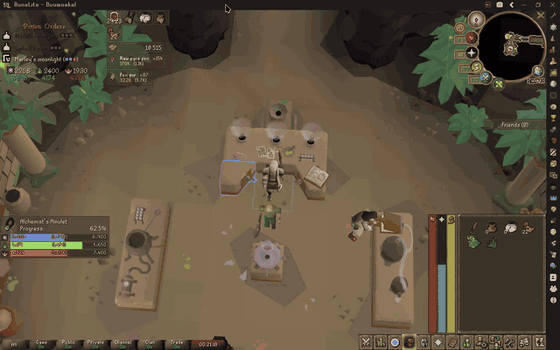
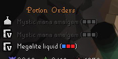

<h1 align="center">Mastering Mixology Extended</h1>

Mastering Mixology Extended is a RuneLite plugin for the Mastering Mixology minigame. It tracks the rewards you are
saving resin for, tells you which orders are worth brewing, walks you through mixing them, and can block the clicks
that would waste a paste or a potion. It builds on [Hexagon's Mastering Mixology plugin](https://github.com/hex-agon/mastering-mixology).

## Features

### Mixing guidance

- **Follow the next step**

  Highlight only the lever for the next paste instead of all three, and turn the mixing vessel and the conveyor belt
  green when they are the next thing to click. Skipped orders draw their recipe in the skip colour, so you can see at
  a glance which ones you are leaving.

  

  

- **Wait for the full order**

  Hold back the station highlight until every order you are making has been mixed.

The vessel and conveyor belt highlights are on by default; everything else in this section is off.

### Misclick protection

- **Lever and potion protection**

  Only the next lever can be pulled, and the vessel will not mix three pastes that make no potion for an open order. If
  the vessel already holds pastes that match no order, every lever stays pullable so you cannot get stuck. A quick
  double click cannot slip a second paste through.

- **Lock idle stations**

  Stop clicks on the Alembic, Agitator or Retort when the station is empty and no order needs it with the potion you are
  holding.

- **Cap Concentrate clicks**

  Stop Retort clicks on the last tick, when passive fill completes the potion anyway, so spare clicks cannot load the
  next potion.

All of these are off by default.

### Reward goals

- **Track several rewards at once**

  Tick any of the rewards you are saving for, with quantities for the potion packs, Aldarium and the Chugging Barrel.
  The overlay shows how far each resin colour is from the combined cost.

- **Know when you can afford it**

  Get a notification the moment your resin covers every reward you ticked.

### Order recommendations

- **Brew or skip, by colour**

  Colour each order green (brew) or red (skip), based on the resin you still need for the rewards you ticked. Pick
  the strategy: Expected value (default), Bottleneck, Adaptive or Greedy. It is off by default and needs at least one
  reward ticked.

### The order list and the lab

- **Recipes in the order list**

  Each order shows its recipe, and the potions in your inventory are tagged with theirs. Orders can be sorted by
  station or by shortest path.

- **Stations, levers and quick actions**

  Highlight the station to use for the potion you are holding, the levers, and the quick-action events, with an option
  to fix the Alembic quick-action sound delay.

- **Digweed**

  Highlight digweed and get a notification when it spawns.

### Accessibility

- **Dyslexic and colour-blind mode**

  Swap the M, A and L letters for colour blocks in the order list and inventory tags, and choose your own colours for the
  resin blocks, levers, progress bars and the brew and skip text.

## Credits

- [Hexagon](https://github.com/hex-agon) wrote the original Mastering Mixology plugin.
- [pdboegel](https://github.com/PDBoegel) built the Extended version: reward goals, the recommendation strategy and the
  accessibility options.
- [Mitchole](https://github.com/Mitchole) contributed misclick protection.

## Links

- [Report a bug](https://github.com/Oveduumnakal/Mastering-Mixology-Extended-Plugin/issues/new?template=bug_report.yml)
- [Request a feature](https://github.com/Oveduumnakal/Mastering-Mixology-Extended-Plugin/issues/new?template=feature_request.yml)
- [Changelog](docs/CHANGELOG.md)
- [Buy me a coffee](https://buymeacoffee.com/oveduumnakal)
