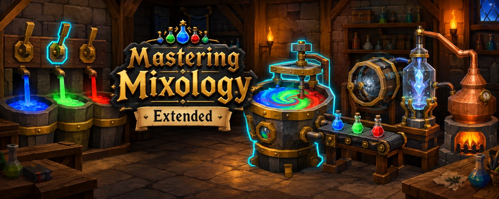
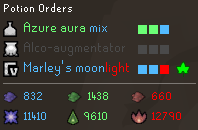
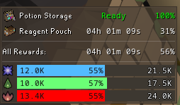
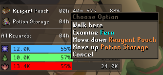
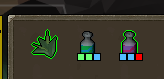
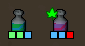
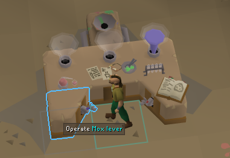
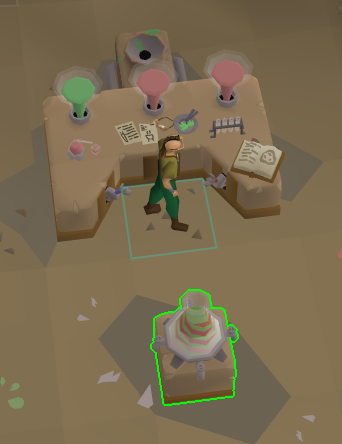
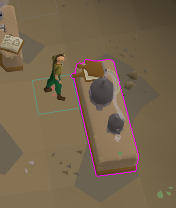
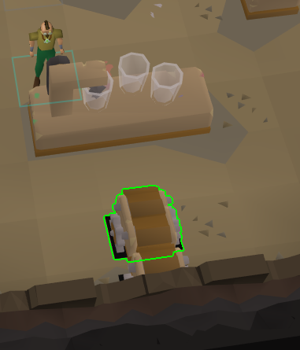

  

<h1 align="center">Mastering Mixology Extended</h1>

Mastering Mixology Extended is a RuneLite plugin for the Mastering Mixology minigame. Tell it which rewards you are saving resin for and it shows you which orders are worth brewing, how long each reward will take, and where to put a digweed when one spawns. It then walks you through the mixing itself — the next lever, the vessel, the station, the conveyor belt — and can block the clicks that would waste a paste or a potion. It builds on [Hexagon's Mastering Mixology plugin](https://github.com/hex-agon/mastering-mixology).

## Features

### A clearer potion orders window

- **Everything about an order at a glance**

  The game's order list is replaced by a cleaner window. Each order shows the station it needs, its name coloured by the pastes that make it, and its recipe as coloured blocks, which turn into "done!" once the potion is ready. Underneath, you can see the paste left in each hopper and your total resin of each colour. Unlike the game's list, the window can go anywhere: hold Alt and drag it to where it suits you.

  

- **Know which orders to brew**

  Once you tick a reward to save for, orders that don't help are greyed out so you can skip them. The default *Expected value* strategy looks at the resin you still need and the time each potion and delivery takes, so your colours finish together with little wasted resin. In simulation it reaches the Reagent Pouch about 15 minutes sooner than counting potions alone. *Bottleneck*, *Adaptive* and *Greedy* (brew everything) are there if you prefer them.

- **Sorted the way you walk**

  Orders are sorted by the shortest path around the lab, or by station if you like. The potions in your inventory are tagged with their recipe, so you always know which is which. Prefer the game's own list? Turn off *Hide orders panel* and the recipes are added to it instead.

### Reward goals

- **Save for several rewards at once**

  Tick any rewards you are working toward. Potion packs, Aldarium and the Chugging Barrel take a quantity instead, so you can aim for twenty Aldarium as easily as one Reagent Pouch.

- **See how long each reward will take**

  The rewards panel gives every reward its own row with an estimated time to finish and how far along you are, then a row for all of them together and a bar for each resin colour. The estimate learns your own pace after 10 deliveries. It counts down while you play and pauses when you stop, and a reward you can already afford shows *Ready*.

  

- **Buy them in your order**

  Rewards are bought top to bottom, so each one counts only the resin left after the ones above it. They're listed in the order you tick them; right-click the panel to move one up or down. Set *Reward Order* to *Each on its own* if you'd rather see every reward against all of your resin.

  

- **Know when you can afford it**

  Get a notification the moment your resin covers everything you ticked. Choose what the middle of each resin bar shows with *Reward Progress*: the percent, the resin still needed, or nothing.

### Digweed

- **Never miss a spawn**

  Digweed is highlighted when it grows, with a notification so you notice it even when you're busy at a station.

- **Know where to put it**

  While you hold a digweed, it and the best potion to add it to are outlined in your inventory, and a leaf flashes on that order. The plugin picks the potion where doubling the resin helps your rewards the most, and counts the digweed when it recommends orders, so an order worth brewing only with the digweed still gets recommended.

  

- **Marked once it's in**

  After you add it, the leaf stays on the order and a small leaf marks the improved potion in your inventory, even after it goes through a station or you log out and back in.

  

### Mixing guidance

- **Follow the next step**

  Only the lever for the next paste is highlighted instead of all three. The mixing vessel, the station for the potion you're holding and the conveyor belt light up when they are the next thing to click, and quick-action events are highlighted the moment they pop. The stations wait until every order you are making has been mixed, so you never walk off with half a set.

   

   

- **Hear the Alembic on time**

  An option fixes the Alembic's quick-action sound, which normally plays a beat late.

### Misclick protection

All of these are off by default; turn on the ones you want.

- **Lever and potion protection**

  Only the next lever can be pulled, and the vessel won't mix three pastes that make no potion for an open order. If the vessel already holds pastes that match no order, every lever stays pullable so you can't get stuck, and a quick double click can't slip a second paste through.

- **Lock idle and running stations**

  Stop clicks on the Alembic, Agitator or Retort when it's empty and no order needs it with the potion you're holding. While the Agitator or Alembic is running, only its quick-action clicks get through.

- **Cap Concentrate clicks**

  Stop Retort clicks on the last tick, when the potion finishes on its own anyway, so a spare click can't load the next potion.

### Colors

- **Blocks or letters, in your colours**

  Recipes show as coloured blocks; turn on *Use Letters* for M, A and L instead. Pick the Mox, Aga and Lye colours (used for recipes, potion names, levers and resin bars), the skip colour, and the station, quick-action and digweed highlight colours, all in one place.

- **Colorblind mode**

  Pick Protanopia, Deuteranopia or Tritanopia for preset Mox, Aga and Lye colours that stay easy to tell apart.

## Credits

- [Hexagon](https://github.com/hex-agon) wrote the original Mastering Mixology plugin.
- [pdboegel](https://github.com/PDBoegel) built the Extended version: reward goals, the recommendation strategy and the accessibility options.
- [Mitchole](https://github.com/Mitchole) contributed misclick protection.

## Links

- [Report a bug](https://github.com/Oveduumnakal/Mastering-Mixology-Extended-Plugin/issues/new?template=bug_report.yml)
- [Request a feature](https://github.com/Oveduumnakal/Mastering-Mixology-Extended-Plugin/issues/new?template=feature_request.yml)
- [Changelog](docs/CHANGELOG.md)
- [Buy me a coffee](https://buymeacoffee.com/oveduumnakal)
